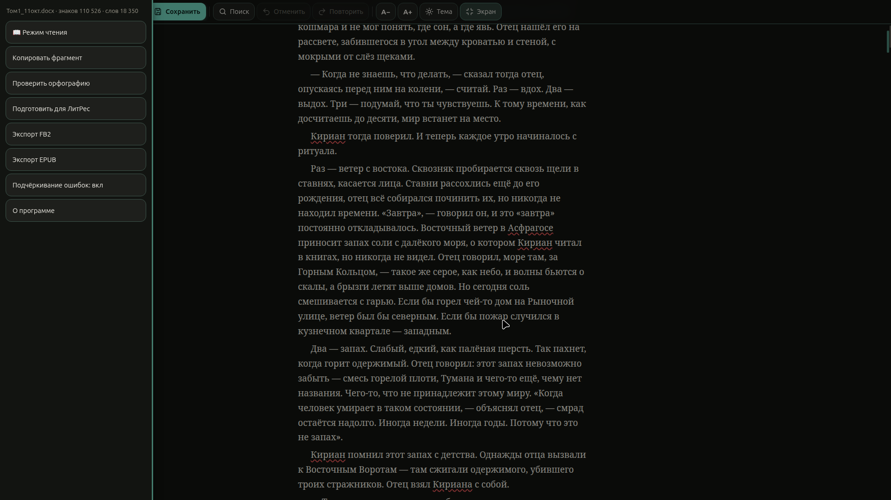
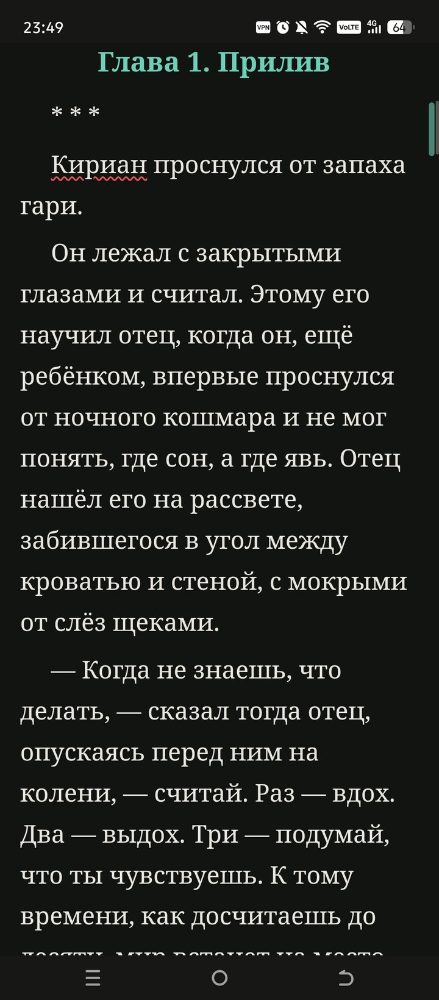
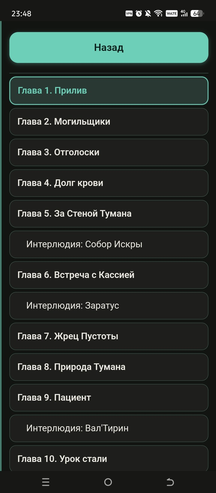
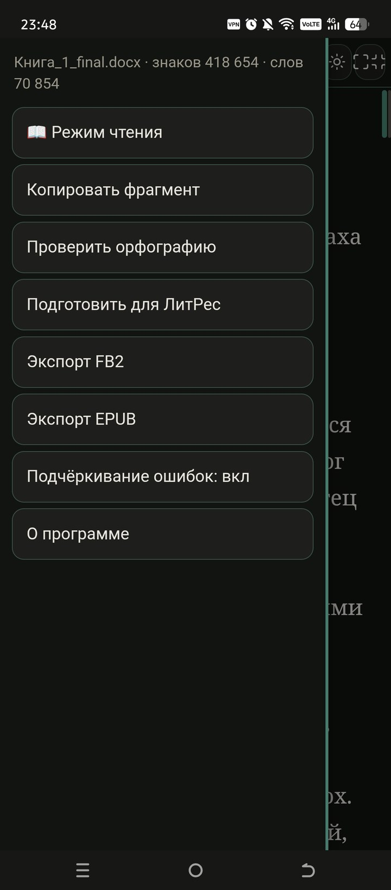
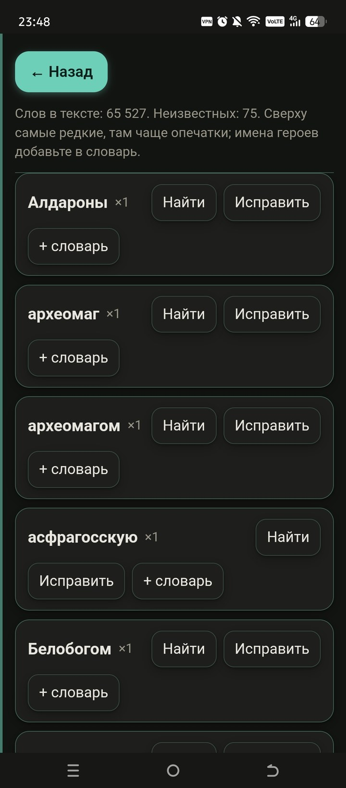

# DOCX editor for writers

**Русская версия:** [README.md](README.md)

A self-contained `.docx` editor for people who work with long texts. One `index.html` file holds the entire editor: no server, no internet, no accounts. Files are opened and saved locally; nothing leaves your machine.

**Download:** [Releases](https://github.com/Caravadgo/docx-editor/releases/latest) — ready-made builds for Linux, Windows and Android.



<table>
  <tr>
    <td align="center"><br><sub>Reading mode</sub></td>
    <td align="center"><br><sub>Chapter list</sub></td>
    <td align="center"><br><sub>Menu</sub></td>
    <td align="center"><br><sub>Spell check</sub></td>
  </tr>
</table>

## Features

- Opens `.docx`, `.txt`, `.md`, `.fb2`; saves to `.docx`; exports to FB2 and EPUB.
- Chapters are detected from document headings: a chapter list with jump-to-section navigation.
- Precise caret restore for every file: the paragraph index and the exact offset inside it are saved, so on reopening the cursor lands between the same letters.
- Bookmarks: a jump list of places in the book, Ctrl+B or the 🔖 button; anchored to paragraphs, stored on the device and shared across file copies.
- Spell checking: Russian Spelling Dictionary 1.0.9 (575,000+ entries, MPL-2.0) and a 49,000-word English dictionary, running in a separate worker.
- Search and replace, undo and redo.
- The draft is saved on the device automatically: after closing or a crash your edits can be restored.
- Reading mode, font size, light and dark themes.
- The header collapses when you scroll down and comes back when you scroll up.
- Menu on the ⋮ button in the header; on Android also a swipe from the left edge of the screen.
- Keyboard shortcuts (Ctrl+S, Ctrl+O, Ctrl+F, Ctrl+M, Ctrl+Z/Y), a first-run hint and an About dialog.
- LitRes text preparation, paragraph-by-paragraph fragment copying, character and word counters.

Three platforms are supported: Linux (AppImage), Windows (a single self-extracting `.exe`) and Android (a WebView wrapper). The web version is the same `index.html` opened in a browser.

## Repository layout

```
index.html          application source (also the web version)
desktop/            Electron wrapper: main.js, preload.js, package.json, icons
android/            Android project (WebView, no Gradle): manifest, Java, resources, assets
docs/               screenshots
licenses/           third-party license texts
```

Important: `desktop/main.js` and `android/app/src/main/assets/docx-editor.html` are copies that must match the root `index.html`. After editing the source, update them as well.

## Building

### Linux (AppImage)

Requirements: no Node.js needed; you do need an unpacked Electron for Linux and [appimagetool](https://github.com/AppImage/appimagetool).

```bash
# 1. the app inside Electron
mkdir -p AppDir/usr/lib/docx-editor/resources
cp -a electron/* AppDir/usr/lib/docx-editor/
mv AppDir/usr/lib/docx-editor/electron AppDir/usr/lib/docx-editor/docx-editor
mkdir -p AppDir/usr/lib/docx-editor/resources/app
cp index.html desktop/{main.js,preload.js,package.json,icon.png} \
   AppDir/usr/lib/docx-editor/resources/app/

# 2. AppRun, .desktop and icons
cp desktop/AppRun AppDir/AppRun && chmod +x AppDir/AppRun
# --no-zygote in AppRun is required: on squashfs the Chromium zygote
# fails to start and the window closes ~10 seconds after launch.

# 3. packaging
ARCH=x86_64 appimagetool AppDir docx-editor-x86_64.AppImage
```

### Windows (single `.exe`)

Uses the 7-Zip SFX module (`7zS.sfx`) and an LZMA archive:

```bash
cd win-app && 7z a -t7z -m0=lzma:d=32m -mx=9 ../payload.7z .
printf ';!@Install@!UTF-8!\nTitle="DOCX editor"\nRunProgram="docx-editor.exe"\n;!@InstallEnd@!\n' > config.txt
cat 7zS.sfx config.txt payload.7z > docx-editor-win-x64.exe
```

### Android

The project is built without Gradle, directly with the SDK tools:

```bash
SDK=$HOME/android-sdk; BT=$SDK/build-tools/34.0.0; AJ=$SDK/platforms/android-34/android.jar
SRC=android/app/src/main

$BT/aapt2 compile --dir $SRC/res -o build/res.zip
$BT/aapt2 link -o build/unsigned.apk -I $AJ --manifest $SRC/AndroidManifest.xml \
    -R build/res.zip --java build/gen --auto-add-overlay -A $SRC/assets
javac -encoding UTF-8 --release 8 -classpath $AJ -d build/obj \
    build/gen/com/example/docxeditor/R.java $SRC/java/com/example/docxeditor/MainActivity.java
$BT/d8 --lib $AJ --min-api 21 --output build/dex $(find build/obj -name '*.class')
(cd build/dex && zip -q ../unsigned.apk classes.dex)
$BT/zipalign -f 4 build/unsigned.apk build/aligned.apk
$BT/apksigner sign --ks release.keystore --ks-key-alias docxeditor --out docx-editor.apk build/aligned.apk
```

The signing key and passwords are not part of the repository.

### Samsung devices

On Samsung phones the system file picker may return its result after the activity has been recreated, when the WebView is still loading; a document passed immediately is lost and the editor stays empty. Since 1.2.4 the file waits for `onPageFinished` before being handed to the editor. Picker errors are shown in a dialog, and the URI is checked for readability before reading.

## License

The code is distributed under the **GNU General Public License v3.0 or later** — see [LICENSE](LICENSE). The bundled dictionary is MPL-2.0, Electron and Chromium are MIT/BSD; the full list and texts are in [THIRD_PARTY_NOTICES.md](THIRD_PARTY_NOTICES.md).

## Support

The project is free, with no ads and no trackers. If the editor saved you time — [support the author on Boosty](https://boosty.to/silas_kraven).
