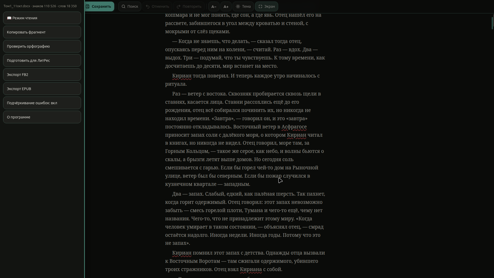
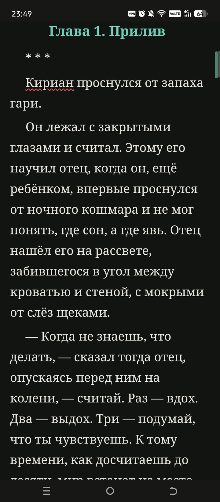
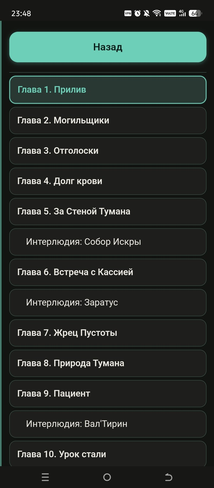
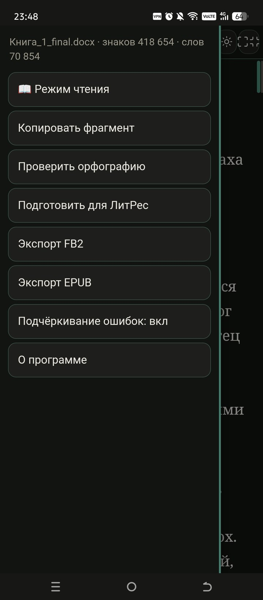
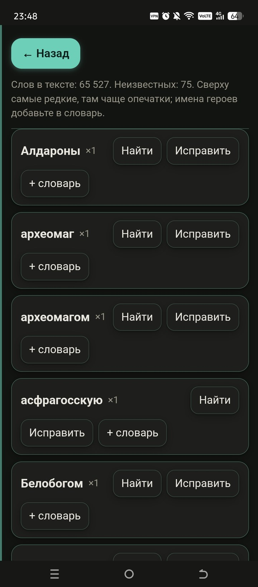

# DOCX-редактор для писателей

Автономный редактор документов `.docx` для тех, кто работает с большими текстами. Один файл `index.html`, внутри — весь редактор: без сервера, без интернета, без аккаунтов. Файлы открываются и сохраняются локально, наружу ничего не уходит.

**Скачать:** [Releases](https://github.com/Caravadgo/docx-editor/releases/latest) — готовые сборки для Linux, Windows и Android.



<table>
  <tr>
    <td align="center"><br><sub>Режим чтения</sub></td>
    <td align="center"><br><sub>Список глав</sub></td>
    <td align="center"><br><sub>Меню</sub></td>
    <td align="center"><br><sub>Проверка орфографии</sub></td>
  </tr>
</table>

## Возможности

- Открытие `.docx`, `.txt`, `.md`, `.fb2`; сохранение в `.docx`; экспорт в FB2 и EPUB.
- Главы определяются по заголовкам документа: список глав с переходом к нужному разделу.
- Проверка орфографии: словарь Russian Spelling Dictionary 1.0.9 (575 000+ записей, MPL-2.0), проверка идёт в отдельном воркере.
- Поиск и замена по тексту, отмена и повтор действий.
- Режим чтения, размер шрифта, светлая и тёмная темы; полноэкранный режим на компьютере (F11).
- Сворачивание шапки при прокрутке вниз и возврат при движении вверх.
- Меню — кнопка ⋮ в шапке; на Android ещё и смахивание от левого края экрана.
- Подготовка текста для ЛитРес, копирование фрагментов по абзацам, счётчик знаков и слов.

Поддерживаются три платформы: Linux (AppImage), Windows (один самораспаковывающийся `.exe`) и Android (WebView-обёртка). Веб-версия — тот же `index.html`, открытый в браузере.

## Структура

```
index.html          исходник приложения (он же веб-версия)
desktop/            обёртка Electron: main.js, preload.js, package.json, иконки
android/            Android-проект (WebView, без Gradle): манифест, Java, ресурсы, assets
docs/               скриншоты
licenses/           тексты сторонних лицензий
```

Важно: `desktop/main.js` и `android/app/src/main/assets/docx-editor.html` — копии, которые должны совпадать с корневым `index.html`. После правок источника их нужно обновлять.

## Сборка

### Linux (AppImage)

Нужны: Node.js не требуется; нужен распакованный Electron для Linux и [appimagetool](https://github.com/AppImage/appimagetool).

```bash
# 1. приложение внутри Electron
mkdir -p AppDir/usr/lib/docx-editor/resources
cp -a electron/* AppDir/usr/lib/docx-editor/
mv AppDir/usr/lib/docx-editor/electron AppDir/usr/lib/docx-editor/docx-editor
mkdir -p AppDir/usr/lib/docx-editor/resources/app
cp index.html desktop/{main.js,preload.js,package.json,icon.png} \
   AppDir/usr/lib/docx-editor/resources/app/

# 2. AppRun, .desktop и иконки
cp desktop/AppRun AppDir/AppRun && chmod +x AppDir/AppRun
# --no-zygote в AppRun обязателен: из squashfs Chromium-zygote
# не поднимается и окно закрывается через ~10 секунд после старта.

# 3. упаковка
ARCH=x86_64 appimagetool AppDir docx-editor-x86_64.AppImage
```

### Windows (один `.exe`)

Используется SFX-модуль 7-Zip (`7zS.sfx`) и архив LZMA:

```bash
cd win-app && 7z a -t7z -m0=lzma:d=32m -mx=9 ../payload.7z .
printf ';!@Install@!UTF-8!\nTitle="DOCX-редактор"\nRunProgram="docx-editor.exe"\n;!@InstallEnd@!\n' > config.txt
cat 7zS.sfx config.txt payload.7z > docx-editor-win-x64.exe
```

### Android

Проект собирается без Gradle, напрямую инструментами SDK:

```bash
SDK=$HOME/android-sdk; BT=$SDK/build-tools/34.0.0; AJ=$SDK/platforms/android-34/android.jar
SRC=android/app/src/main

$BT/aapt2 compile --dir $SRC/res -o build/res.zip
$BT/aapt2 link -o build/unsigned.apk -I $AJ --manifest $SRC/AndroidManifest.xml \
    -R build/res.zip --java build/gen --auto-add-overlay -A $SRC/assets
javac -encoding UTF-8 --release 8 -classpath $AJ -d build/obj \
    build/gen/com/example/docxeditor/R.java $SRC/java/com/example/docxeditor/MainActivity.java
$BT/d8 --lib $AJ --min-api 21 --output build/dex $(find build/obj -name '*.class')
(cd build/dex && zip -q ../unsigned.apk classes.dex)
$BT/zipalign -f 4 build/unsigned.apk build/aligned.apk
$BT/apksigner sign --ks release.keystore --ks-key-alias docxeditor --out docx-editor.apk build/aligned.apk
```

Ключ подписи и пароли в репозиторий не входят.

## Лицензия

Код распространяется по **GNU General Public License v3.0 or later** — см. [LICENSE](LICENSE). Встроенный словарь распространяется по MPL-2.0, Electron и Chromium — по MIT/BSD; полный список и тексты — в [THIRD_PARTY_NOTICES.md](THIRD_PARTY_NOTICES.md).

## Поддержка

Проект бесплатный, без рекламы и трекеров. Если редактор сэкономил вам время — [поддержать автора на Boosty](https://boosty.to/silas_kraven).

---

## English

A self-contained `.docx` editor for writers: a single `index.html` with no network access, packaged for Linux (AppImage), Windows (single self-extracting `.exe`) and Android (WebView). Licensed under GPL-3.0-or-later; the bundled Russian dictionary is MPL-2.0.
