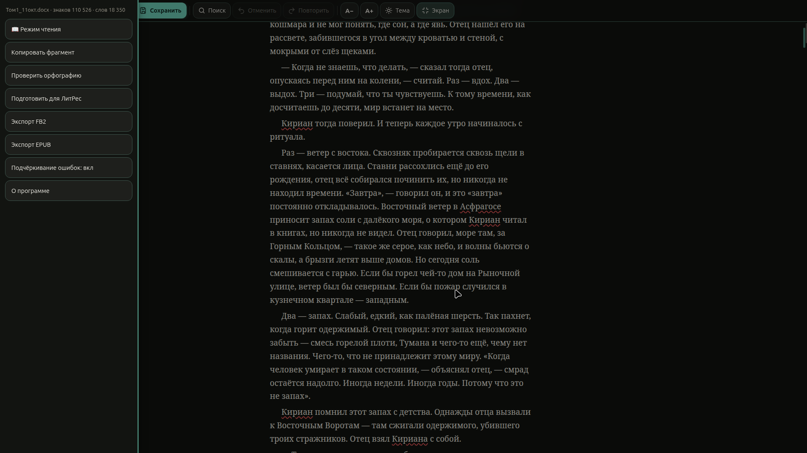
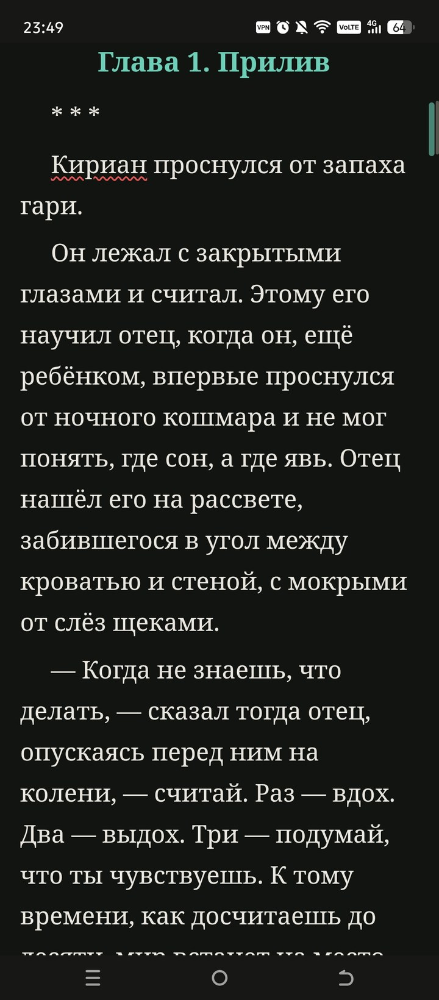
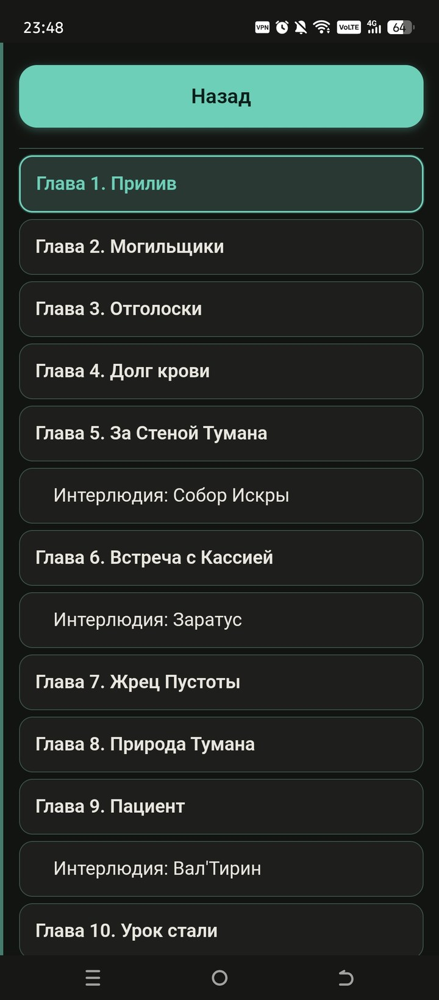
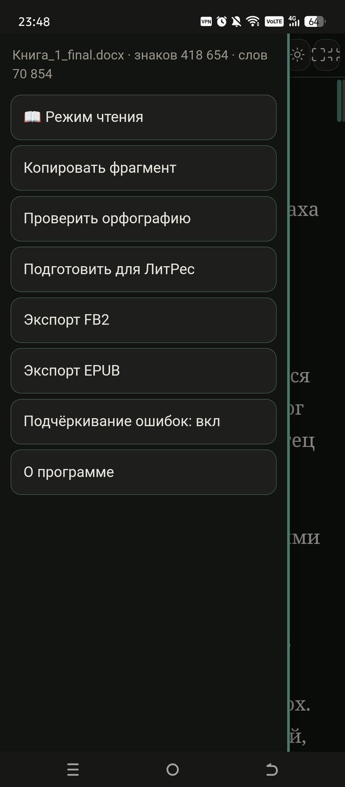
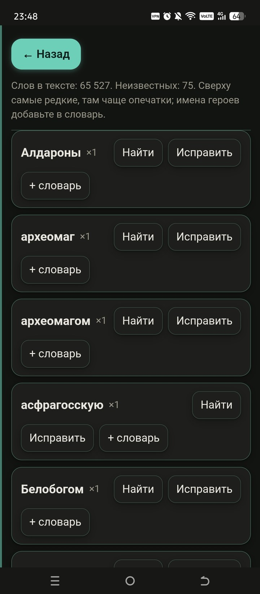

# DOCX-редактор для писателей

**Русский** · [English](README.en.md)

Автономный редактор документов `.docx` для тех, кто работает с большими текстами. Один файл `index.html`, внутри — весь редактор: без сервера, без интернета, без аккаунтов. Файлы открываются и сохраняются локально, наружу ничего не уходит.

**Скачать:** [Releases](https://github.com/Caravadgo/docx-editor/releases/latest) — готовые сборки для Linux, Windows и Android.



<table>
  <tr>
    <td align="center"><br><sub>Режим чтения</sub></td>
    <td align="center"><br><sub>Список глав</sub></td>
    <td align="center"><br><sub>Меню</sub></td>
    <td align="center"><br><sub>Проверка орфографии</sub></td>
  </tr>
</table>

## Возможности

- Открытие `.docx`, `.txt`, `.md`, `.fb2`; сохранение в `.docx`; экспорт в FB2 и EPUB.
- Главы определяются по заголовкам документа: список глав с переходом к нужному разделу. Если стили заголовков потеряны (частый случай после конвертации), главы находятся по разметке абзацев — «Глава 40. …», «Пролог», «Эпилог» и подобным, а при её отсутствии по оформлению: по центру, жирным, крупнее основного текста.
- Точное восстановление каретки для каждого файла: сохраняются номер абзаца и смещение внутри него — при открытии курсор встаёт между теми же буквами.
- Закладки: список мест в книге с переходом, Ctrl+B или кнопка 🔖; привязаны к абзацам, хранятся на устройстве и общие для копий файла.
- Проверка орфографии: Russian Spelling Dictionary 1.0.9 (575 000+ записей, MPL-2.0) и английский словарь на 49 000 слов; проверка идёт в отдельном воркере.
- Поиск и замена по тексту, отмена и повтор действий.
- Черновик сохраняется на устройстве автоматически: после закрытия или сбоя правки можно восстановить.
- При запуске редактор сам открывает последний документ — в том виде, в каком он был сохранён.
- Режим чтения, размер шрифта, светлая и тёмная темы.
- Сворачивание шапки при прокрутке вниз и возврат при движении вверх.
- Меню — кнопка ⋮ в шапке; на Android ещё и смахивание от левого края экрана.
- Горячие клавиши (Ctrl+S, Ctrl+O, Ctrl+F, Ctrl+M, Ctrl+Z/Y), подсказка при первом запуске и окно «О программе».
- Подготовка текста для ЛитРес, копирование фрагментов по абзацам, счётчик знаков и слов.

Поддерживаются четыре платформы: Linux (AppImage), Windows (один самораспаковывающийся `.exe`), Android (WebView-обёртка) и Chrome-расширение (Manifest V3). Веб-версия — тот же `index.html`, открытый в браузере.

## Структура

```
index.html          исходник приложения (он же веб-версия)
desktop/            обёртка Electron: main.js, preload.js, package.json, иконки
android/            Android-проект (WebView, без Gradle): манифест, Java, ресурсы, assets
extension/          Chrome-расширение (Manifest V3), генерируется build.mjs
fastlane/           описание, иконка, скриншоты и changelog для F-Droid
tools/              сборочные скрипты
docs/               скриншоты
licenses/           тексты сторонних лицензий
```

Важно: `android/app/src/main/assets/docx-editor.html` — копия, которая должна совпадать с корневым `index.html`; после правок источника её нужно обновлять. `desktop/main.js` — процесс Electron, а не копия приложения. Файлы `extension/index.html`, `extension/app.js` и `extension/vendor/jszip.js` генерируются из `index.html` командой `node extension/build.mjs`.

## Сборка

### Linux (AppImage)

Нужны: Node.js не требуется; нужен распакованный Electron для Linux и [appimagetool](https://github.com/AppImage/appimagetool).

```bash
# 1. приложение внутри Electron
mkdir -p AppDir/usr/lib/docx-editor/resources
cp -a electron/* AppDir/usr/lib/docx-editor/
mv AppDir/usr/lib/docx-editor/electron AppDir/usr/lib/docx-editor/docx-editor
mkdir -p AppDir/usr/lib/docx-editor/resources/app
cp index.html desktop/{main.js,preload.js,package.json,icon.png} \
   AppDir/usr/lib/docx-editor/resources/app/

# 2. AppRun, .desktop и иконки
cp desktop/AppRun AppDir/AppRun && chmod +x AppDir/AppRun
# --no-zygote в AppRun обязателен: из squashfs Chromium-zygote
# не поднимается и окно закрывается через ~10 секунд после старта.

# 3. упаковка
ARCH=x86_64 appimagetool AppDir docx-editor-x86_64.AppImage
```

### Windows (один `.exe`)

Используется SFX-модуль 7-Zip (`7zS.sfx`) и архив LZMA:

```bash
cd win-app && 7z a -t7z -m0=lzma:d=32m -mx=9 ../payload.7z .
printf ';!@Install@!UTF-8!\nTitle="DOCX-редактор"\nRunProgram="docx-editor.exe"\n;!@InstallEnd@!\n' > config.txt
cat 7zS.sfx config.txt payload.7z > docx-editor-win-x64.exe
```

### Android

Android-проект собирается без Gradle, напрямую инструментами SDK:

```bash
KEYSTORE=release.keystore tools/build-android.sh
# → build/docx-editor-1.3.20-android.apk
```

Версия берётся из `AndroidManifest.xml`; скрипт откажется собирать, если
`desktop/package.json` или `extension/manifest.json` расходятся с ней.
Ключ подписи и пароли в репозиторий не входят, порог `versionCode` для
обновления — тоже в манифесте. Порядок выпуска версии — [RELEASING.md](RELEASING.md).

### Chrome-расширение

```bash
node extension/build.mjs      # пересобирает extension/ из index.html
```

`chrome://extensions` → «Режим разработчика» → «Загрузить распакованное» → папка
`extension/`. Клик по иконке открывает редактор отдельным окном без адресной
строки, `Alt+Shift+D` — та же команда.
### Особенности Samsung

На смартфонах Samsung системный выбор файла иногда возвращает результат уже после того, как Activity пересоздана: WebView в этот момент ещё загружается, и переданный сразу документ теряется — редактор остаётся пустым. Начиная с версии 1.2.4 открытие ждёт окончания загрузки страницы (`onPageFinished`) и только потом отдаёт файл в редактор. Ошибки выбора файла показываются диалогом, а URI проверяется на доступность до чтения.

## Лицензия

Код распространяется по **GNU General Public License v3.0 or later** — см. [LICENSE](LICENSE). Встроенный словарь распространяется по MPL-2.0, Electron и Chromium — по MIT/BSD; полный список и тексты — в [THIRD_PARTY_NOTICES.md](THIRD_PARTY_NOTICES.md).

## Поддержка

Проект бесплатный, без рекламы и трекеров. Если редактор сэкономил вам время — [поддержать автора на Boosty](https://boosty.to/silas_kraven).

---

**English version:** [README.en.md](README.en.md) — the full translation of this page.
